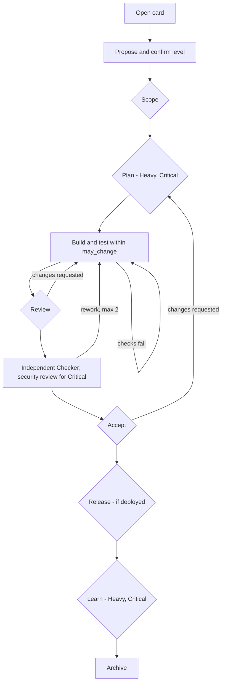

# MeshikahAI Operating Model

**Status:** Draft for owner approval
**Version:** 2.0, aligned with the MeshikahAI package v0.1 (`docs/02-operating-model.md`). Supersedes Model 1.1.
**Framework layer:** Layer 2, the Model: *who does what, when, at which risk level, and with what proof*
**Parent:** [`MeshikahAI_operating_standard.md`](MeshikahAI_operating_standard.md) (cited as "Standard §n")
**Runtime:** [`MeshikahAI_operating_system.md`](MeshikahAI_operating_system.md) (cited as "OS §n") · CLI: [`MeshikahOS_cli_technical_spec.md`](MeshikahOS_cli_technical_spec.md)

> **Precedence:** Standard > this Model > OS, CLI and bindings > project extensions. Extensions may narrow this model, never loosen it.

---

## 1. Purpose

The Standard says what must be true. This Model says who does what, when, and with what proof, when people and AI agents deliver work together.

An AI agent is an implementation partner. It is **never** the final authority on scope, architecture, security, acceptance, release, or anything destructive.

## 2. Operating principles

1. **The owner owns the outcome.** Delegating work to an agent doesn't delegate accountability.
2. **Context before change.** The agent loads the card's listed context (Standard §6) before acting.
3. **Inspect before proposing.** Read the current code and reproduce the problem before suggesting a fix.
4. **Acceptance before code.** Testable acceptance criteria exist before implementation starts.
5. **Plan before code**, reviewed by a human where the level requires it.
6. **Scope is the card.** Anything outside `may_change` needs the owner's approval.
7. **Separate building from checking.** Independence grows with the level.
8. **Evidence before claims.** If it wasn't checked, it is `NOT VERIFIED`.
9. **Keep truth states apart:** current, proposed, historical, open question.
10. **Humans decide consequential matters:** business, design, security, release, destructive.
11. **Sensitive data stays out** of prompts, logs and artifacts.
12. **Be proportionate.** Light work stays light.

## 3. Roles

### 3.1 Human roles

| Role | Owns |
|---|---|
| **Owner** | The outcome. Frames the problem, proposes the level, selects context, reviews plans and diffs, judges evidence, communicates limitations honestly, and runs releases. |
| **Approver** | The decision at a checkpoint. The approver depends on the checkpoint: product (Scope, Accept), architecture (Plan), quality (Accept), security (Critical security review), release (Release), library owner (Learn). |

One person may hold several roles. The roles and their decisions stay distinct (§3.6).

### 3.2 AI roles

| Role | Does | Never does |
|---|---|---|
| **Builder** | Explores, plans, implements and tests within the card's scope; updates the card's files; reports honestly | Records a decision; edits the library directly; acts outside `may_change` without asking |
| **Checker** | Independently verifies the Builder's work in a fresh session, ideally on a different model family; re-runs tests; reviews the diff against the plan and the acceptance | Fixes the code it checks; sees the Builder's reasoning; records a decision |
| **Librarian** | At close, proposes what should be promoted into the library: lessons, architecture updates, prompts | Writes to the library without the Learn decision |

The Librarian may be an agent or a person.

### 3.3 Role identifiers

Used in the record and by the CLI: `human:<name>` for people (for example `human:armando`), and `agent:builder`, `agent:checker`, `agent:librarian` for agents. Optional specialist roles (§18) use `agent:<specialist>`.

### 3.4 Builder responsibilities

Explore the repository within authorized access; classify the work (§4); root-cause analysis (§11.2) and planning (§11.1); code and tests within `may_change`; keep `plan.md`, `evidence.md` and `notes/` current; run the approved verification commands; request checkpoints; end every session with the reporting contract (§16); ask when requirements conflict or are ambiguous.

### 3.5 Decision rights

`A` decides, `R` does the work, `C` is consulted. **An agent never holds `A`.**

| Decision | Owner | Product | Architecture | Quality | Security | Library owner | Agents |
|---|---|---|---|---|---|---|---|
| Level | **A** | – | C | – | C | – | Propose |
| Scope | R | **A** | C | C | – | – | Draft |
| Plan | R | C | **A** | – | C | – | Draft |
| Review (diff matches plan) | **A** | – | C | – | – | – | Implement |
| Security review (Critical) | R | – | C | – | **A** | – | Check |
| Accept | R | **A** | – | **A** | A (Critical) | – | Verify |
| Release | **A** (executes) | C | C | **A** | A (Critical: second human) | – | Prepare |
| Learn (promotion) | R | – | C | – | – | **A** | Propose |
| Destructive change or data migration | R | **A** | **A** | **A** | C | – | Prepare |

Agents never decide on their own: business requirements, security exceptions, production data deletion, destructive migrations, access-control changes, compliance questions, or release.

### 3.6 Small teams: one person, several hats

When the person who reviews is also the person who built or planned, independence has to come from somewhere else:

| Level | Compensating control |
|---|---|
| Light | None needed |
| Standard | The Checker runs in a fresh session on a different model family |
| Heavy | The Standard control, plus the plan is reviewed at least one working session after it was written |
| Critical | The Standard control, plus a second human for the security review and Release. With no second human, the work is not run as Critical. |

The record notes which control was used (OS §4.3).

## 4. Work-item types

The Builder classifies the item first, because type decides the sequence and the proof.

| Type | Sequence | Distinct proof |
|---|---|---|
| **Story** | Understand → affected architecture → acceptance → implement → test → human acceptance | Every criterion evidenced, including negative cases |
| **Enhancement** | Story sequence plus a regression check | No regression in existing behavior |
| **Bug / defect** | Reproduce → expected vs actual → root cause → regression test → fix → verify | Regression test fails before the fix and passes after |
| **Incident** | Stabilize → preserve evidence → blast radius → approved mitigation → verify recovery → root cause → follow-ups | Recovery verified; follow-ups exist as cards |
| **Task** | Define done → execute → verify | Done criteria evidenced |
| **Technical debt** | Define invariants → characterization tests → refactor → verify | Behavior unchanged, proven by tests |
| **Documentation** | Audience → source of truth → write → validate → approval → publish | Approval recorded; links resolve |

## 5. Risk levels

The owner proposes a level when the card opens, and a human confirms it before work starts (`level_confirmed` in the record).

| Level | Typical signals | Shape |
|---|---|---|
| **Light** | Typo, comment, docs-only, one-line config | Builder only |
| **Standard** | One component, clear acceptance, no schema or security impact | Builder, then an independent Checker |
| **Heavy** | Several components, data-contract change, unclear requirements, cross-team dependency | Builder with an explicit plan review, plus Checker and Librarian |
| **Critical** | Security, permissions, sharing/field-level access, regulated data, integrations, migrations, destructive change, production-impacting configuration | Everything in Heavy, plus a separate security review and a second human at Release |

### 5.1 Escalation and floors

- Anyone who finds signs of a higher level **stops** and returns the card to the owner.
- Lowering a level needs human agreement.
- **Data sets a floor:** Regulated data means Critical; Confidential data means at least Standard (Standard §8.1).
- An incident may start with an owner-approved stabilization action before the card's formal steps.

### 5.2 Pre-approved change patterns

Recurring, well-understood changes don't need a fresh plan review each time. A project may register **change patterns** in its extension (§21), each with:

- an ID and name (for example `SCP-003 Add a field to an existing FlexCard`);
- a fixed plan template: files to touch, files not to touch, test map;
- the verification it always requires;
- a one-time architecture approval, stored as a decision record.

A Heavy card that matches a registered pattern satisfies its **Plan** checkpoint by citing the pattern ID in the record. Patterns never apply to Critical cards, to Confidential or Regulated data, or to destructive changes. A pattern is revoked if two cards using it produce defects found after Accept.

### 5.3 Checkpoint service targets

Checkpoints protect quality only if they don't become the bottleneck. Each project sets its own targets; these are defaults.

| Checkpoint | Target from request to decision | Delegate when the approver is away |
|---|---|---|
| Scope | 1 working day | Owner, for Light and Standard |
| Plan | 2 working days | Named deputy architect |
| Review | Same day | Another engineer of equal or higher seniority |
| Security review (Critical) | 3 working days | None. The card waits. |
| Accept | 2 working days | Named deputy product owner plus quality |
| Release | Per release calendar | None |
| Learn | 5 working days | None. Delivery isn't blocked; the proposal waits. |

Cycle time is derived from the record (OS §11). A target missed repeatedly is a process finding, never a reason to skip the checkpoint.

## 6. Checkpoints

A checkpoint is a human decision, recorded with who decided, when and on what evidence.

| Checkpoint | Question | Evidence | Light | Standard | Heavy | Critical |
|---|---|---|---|---|---|---|
| **Scope** | Do we understand and bound the work? | `card.md` with testable acceptance | — | ✓ | ✓ | ✓ |
| **Plan** | Is the approach sound and the change bounded? | `plan.md`: files to touch, files not to touch, test map | — | — | ✓ | ✓ |
| **Review** | Does the diff match the plan? | Diff against base, test and lint output | ✓ | ✓ | ✓ | ✓ |
| **Accept** | Does it meet the contract? | `evidence.md`, every criterion classified; for Critical, the security review | — | ✓ | ✓ | ✓ (with security) |
| **Release** | May this exact change be deployed? | Package matching the diff, dry run, rollback note | if deployed | if deployed | if deployed | ✓ (2 humans) |
| **Learn** | What becomes durable knowledge? | Promotion proposal linked back to the card | — | — | ✓ | ✓ |

### 6.1 Rules

- Agents may **request** a checkpoint. Only humans **decide** one.
- A decision is `approved`, `rejected` or `changes-requested`.
- Checkpoints are decided in order. Accept needs Review approved; Release needs Accept approved.
- A rejected checkpoint sends the card back for rework. After **two** rework rounds the owner must re-scope or re-plan.
- A checkpoint that doesn't apply to the level is skipped, never silently passed.

### 6.2 Flow

```text
open → set level → [Scope] → [Plan] → build + test → [Review]
     → independent check → [Accept] → [Release] → [Learn] → archive
```



## 7. Who works at each phase

| Phase | Light / Standard | Heavy / Critical | Main artifact |
|---|---|---|---|
| Open and classify | Owner + Builder | Owner + Builder (optionally Analyst, §18) | `card.md` |
| Context and exploration | Builder | Builder | Files read, listed in the session report |
| Root cause or design | Builder | Builder (optionally Designer, §18) | `plan.md` |
| Implementation | Builder | Builder | Diff, `notes/` |
| Independent check | Checker (Standard) | Checker; separate security review (Critical) | `evidence.md`, check report |
| Release | Owner | Owner + second human (Critical) | Deployment proof in the record |
| Close | Builder drafts the report | Librarian | Promotion proposals |

## 8. Information authority

Each type of information has one authoritative home.

| Information | Authority | Purpose |
|---|---|---|
| Ticket status, assignee, priority | Tracker (e.g. Jira) | Delivery system of record |
| Scope, plan, evidence for one item | `work/<KEY>/` | The work card |
| Human decisions for one item | `work/<KEY>/record.jsonl` | Audit trail |
| Cross-card architecture and current behavior | `library/` | Current truth |
| Long-lived decisions | `library/decisions/` | Decision records |
| Source implementation | Source folders and Git | Deployable code |
| Deployed metadata and runtime behavior | The named target environment | Runtime truth |
| Enterprise context (search, wikis) | Governed enterprise search | Context only; never overrides runtime truth |

When a library document needs card information, it links to the card; it never copies it. The library changes only when current truth changes, through Learn. When two authorities disagree and no rule settles it, the card stops and an open question goes to a human (OS §9.3).

## 9. Card metadata and decision artifacts

### 9.1 Card header

The top of `card.md`, kept short:

```markdown
# ABC-123 · Retry failed sync calls

- Level: Standard (confirmed by human:armando, 2026-11-02)
- Highest data class: Internal
- Owner: Armando
- Type: story
- Tracker: <url>
- Change pattern: none
- Related: ABC-118, library/architecture/sync.md
```

`context.json` carries the machine-readable `key`, `title`, `level` and `data_class` (Standard §6.2). Release traceability (spec version, deployed reference, deployment ID) lives in the record's `released` event (OS §4.11), not in the card.

### 9.2 Decision artifacts

| Artifact | Location | Content |
|---|---|---|
| Decision record `DEC-###` | `library/decisions/` | Decision, rationale, approver, date, alternatives, consequences |
| Open question `Q-###` | `library/questions/` or the card's open questions | Question, owner, due date |
| Lesson `L-###` | `library/lessons.md` | Symptom, root cause, resolution, evidence |
| Review packet (optional) | `work/<KEY>/notes/` | Material prepared for a human decision |
| Context sync (optional) | `work/<KEY>/notes/` | Sanitized resume point for the next session (OS §4.7) |

### 9.3 Audience routing

| Audience | Start with |
|---|---|
| New developers | `library/index.md`, architecture, a recent closed card |
| Senior developers | Architecture, `plan.md`, source, evidence |
| Architects | Architecture, decisions, plans of Heavy and Critical cards |
| Business stakeholders | `card.md` acceptance, `evidence.md`, release decisions |
| Quality | Acceptance, `evidence.md`, known gaps |

## 10. Context practice

Every session starts from the card. The owner (or the binding) gives the agent: the repository, the card key, its type and level, the objective, and the instruction to follow the load order (Standard §6.1). Everything else comes from `card.md`, `plan.md` and `context.json`, not from the prompt.

| Order | Source | Load-order step |
|---|---|---|
| 1 | `MESHIKAH.md`, `library/index.md`, `context.json` | Orient |
| 2 | Library documents listed in `context.json`, including relevant lessons | Library |
| 3 | `card.md`, `plan.md`, listed source files, `git status`, authorized targeted retrieval | Work |
| 4 | Test procedures and runbooks | Verify |
| 5 | `archive/`, **only** if the card is about history | Out of active context |

## 11. Engineering rules

### 11.1 Plan before code

Identify affected components, contracts, data model, permissions, tests, documentation, deployment impact and rollback. Classify each change:

| Change | Path |
|---|---|
| Code | Review → tests → Release |
| Runtime data | Separate approval; scripted, reviewed, reversible where possible |
| Metadata or configuration | Scoped deployment, dry run first |
| Infrastructure | Owner approval; change window |
| Business decision | Decision record; never decided by an agent |
| Documentation only | Approval; Learn rules for the library |

For Heavy and Critical, the plan is reviewed at the Plan checkpoint and lists files to touch, files not to touch, guardrails and the acceptance → test map.

### 11.2 Root-cause analysis

Never start with a speculative fix. **Reproduce** → **trace** (UI event → client state → API → server → data access → response → render) → **isolate** (state, configuration, contract, data quality, permission, timing, caching, error handling, environment) → **prevent regression** (a test that fails before the fix and passes after). A reproduced pitfall becomes a lesson proposal.

### 11.3 Implementation rules

Follow existing conventions. Preserve security: user-mode data access, object- and field-level checks, allowlisted operators, ownership checks, input validation. **Never weaken security to make a test or deployment pass.** Preserve contracts. Avoid unrequested scope.

### 11.4 Destructive changes

An agent never deletes production data, fields, picklist values, configuration or infrastructure on its own. A destructive change runs as **Critical** and proceeds only after: business confirmation of exact names → architecture confirms the target model and migration → dependency inventory → historical and reporting needs → retention or migration with evidence → human review of the destructive package → approved window and recovery plan → human-executed Release → post-release validation → recorded evidence. **Hiding something from a layout or UI is not deletion and must never be reported as deletion.**

## 12. Verification and evidence

### 12.1 Verification ladder

1. **Focused:** compile check, focused unit test, targeted integration test, reproduction steps.
2. **Full:** the project suite: unit, integration, static analysis, type checks, build or dry-run deploy, security checks.
3. **Manual:** for user-visible work: persona, environment, steps, expected, actual, proof.
4. **Independent:** re-run by the Checker in a fresh session (Standard and above).

### 12.2 Evidence format

```markdown
- Criterion:   <Given / When / Then reference>
- Environment: <where it ran>
- Command or steps:
- Expected:
- Actual:
- Result:      PASS | FAIL | NOT VERIFIED
- Proof:       <log path, job ID, screenshot>
```

Results come from real output. Illustrative numbers are never results. Coverage alone is not proof of behavior.

## 13. Pre-merge and pre-release checklist

- [ ] **Context integrity:** every file the agents read is in `context.json`, the library, or the card, or the deviation is explained.
- [ ] **Boundary:** the diff contains only files in `may_change` and the plan.
- [ ] **Independence:** the Builder didn't accept its own work; the Checker ran where the level requires; the small-team control is noted.
- [ ] **Security:** every data operation follows the project's security pattern or has an approved exception.
- [ ] **Evidence:** every acceptance criterion is `PASS`, `FAIL` or `NOT VERIFIED`, with proof.
- [ ] **Release traceability:** package matches the diff, dry run recorded, Release decided, `released` event written.
- [ ] **Knowledge:** lessons and library changes are proposed for Learn, not written directly.

## 14. Version control

- **Branches:** `<type>/<KEY>-<short-purpose>` (`feature`, `bug`, `chore`, `hotfix`). Branches are temporary; cards and the record give durable traceability.
- **Workflow:** approved ticket → branch → `mshkh new` (or the template by hand) → plan → code and tests on one branch → evidence → PR → merge after the required decisions → Release → Learn → archive.
- **Commits:** grouped by card; messages state scope and why. Agents commit or push only when assigned (Write: shared is "ask" by default, OS §6.1).
- **PR minimum:** card key and link, related cards, summary, tests with results, deployment impact, limitations, reviewers, links to evidence and decisions.

## 15. Closeout and Learn

| Output | Destination | Decision |
|---|---|---|
| Reproduced and resolved pitfalls | `library/lessons.md` (`L-###`) | Learn |
| Durable architecture, data or standard changes | `library/`, as a promotion diff linked to the card and decision | Learn |
| Reusable prompts | Prompt library with a stable ID | Learn |
| Cross-project practice | Workspace library | Learn |
| Personal capability reflection | The person's own portfolio; "no change" is valid | The person |
| Closed card | `archive/` | Owner |

After a material milestone the Builder may write a sanitized context-sync note so the next session can resume (OS §4.7). It never replaces a decision.

## 16. Reporting contract

Every agent session ends with:

```markdown
## Session report
### Card
<key, title, type, level>
### Root cause or design decision
### What changed
### Files changed
### Files read beyond context.json (and why)
### Tests
- Command: / Result: / Coverage:
### Deployment
- Environment: / Deployment ID: / Status (or "not deployed")
### Acceptance
- Criterion: / Result: / Proof:
### Known limitations
### Decisions needed from a human
### Next step
```

## 17. Security and data handling

Agents must not: commit secrets or print credentials; put unredacted production data, personal data or regulated data into any file, prompt or log; harvest credentials, cookies or keys; delete data or run destructive commands; bypass hooks, permissions or security policies; push, merge or rewrite history without instruction; use tools or models not approved for the card's data class.

## 18. Optional specialist roles (proposal)

The package keeps two agent roles, Builder and Checker, plus the Librarian. A team may split Heavy and Critical work further, **only when coordination cost is lower than the value** and after a pilot shows it:

| Specialist | Takes from | Output |
|---|---|---|
| `agent:analyst` | Builder (intake) | Draft `card.md`: problem, scope, acceptance, open questions |
| `agent:designer` | Builder (design) | Draft `plan.md` for the Plan checkpoint |
| `agent:security` | Checker (Critical) | Security review with file and line references |

Specialists follow the same rules as the Builder and Checker: fresh sessions, `may_change` limits, request but never decide. Handoffs between them are notes in `notes/` plus a `note` event in the record (OS §5.3). This module stays a proposal until a pilot produces evidence.

## 19. Prompts, training, and reflection

| Asset | Role |
|---|---|
| Prompt library (`P-###`) | Reusable, ID-stable instructions for Builder, Checker, Librarian and specialists |
| Walkthrough and training material | Teaching the method; never a policy source |
| Personal portfolio | Optional, private reflection at close (Standard §10) |

## 20. Success, done, and measurement

**A card is done when:**

- only planned files changed;
- every acceptance criterion has a result and proof;
- a human decided each required checkpoint;
- the owner understands every change;
- the next session could resume from the card and the library alone.

**Candidate metrics** (derived from the record, OS §11): rework rounds per card, defects found after Accept, issues caught at Scope, Plan or Review versus later, files read per session, checkpoint cycle time, lessons accepted per card. Each needs a baseline, period, sample and method before it is published (Standard §14). Metrics describe the process, never individual people.

## 21. Project extensions

A project may extend this model in its own library. An extension links here, doesn't repeat general content, contains only project facts, may narrow but never loosen, and states which Model version it extends. It declares:

- **Path mapping** (`meshikah.yaml`, OS §3.2) and, for older repositories, the legacy profile.
- **Tracker mapping** from the tracker workflow to card state (OS §5.2). The tracker stays the authority for status; the mapping only lets tooling detect disagreement. Example:

  | Tracker state | Card state |
  |---|---|
  | Requirement Gathering | opened, scoped |
  | In Development | planned, building |
  | Smoke Test / Ready in QA | reviewed, checking |
  | Ready in UAT | checking (Accept requested) |
  | Deployed to prod | released |
  | Completed | learned or archived |

- **Change patterns** (§5.2) and **checkpoint service targets** (§5.3).
- **Data classes** the project handles and the approved tools and models for each.
- **Source-of-truth policy** (Standard §5).

## 22. Document history

| Version | Change |
|---|---|
| 1.0 | Generalized from the Docs Hub pilot operating model |
| 1.1 | Role IDs; small-team controls; data-class floor; change patterns; gate service targets; tracker mapping |
| **2.0** | Aligned with MeshikahAI package v0.1: roles Owner, Approver, Builder, Checker, Librarian; levels Light–Critical; checkpoints Scope, Plan, Review, Accept, Release, Learn (security review folded into Critical); work card and record vocabulary; change patterns satisfy Plan for Heavy cards; former Agents 1–2 become an optional specialist module. Breaking rename. |
