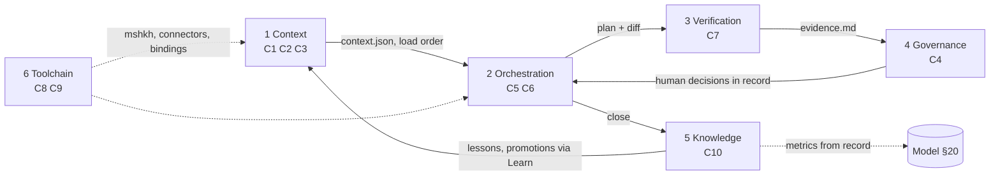

# MeshikahAI Operating Sub-Systems

**Document type:** Layer 3 decomposition of the [MeshikahAI Operating System](MeshikahAI_operating_system.md) ("OS §n")
**Version:** 2.0, aligned with the MeshikahAI package v0.1. Supersedes 1.1.
**Status:** Sub-systems 1–2 proven by hand in the Docs Hub pilot (under 1.x names). Sub-systems 3–6 specified, awaiting evidence.

> The sub-systems group the OS components C1–C10. They add no contracts of their own: every rule cited here is defined in the [Standard](MeshikahAI_operating_standard.md), the [Model](MeshikahAI_operating_model.md) or the OS. If this document and the OS disagree, the OS wins.

---

## Matrix

| # | Sub-system | Focus | Components | Main OS sections | Checkpoints it serves | Standard branch |
|---|---|---|---|---|---|---|
| 1 | Context Management | What the agent reads | C1 Library, C2 Context index, C3 Loader | §3, §4.1, §5.1 | All | Core |
| 2 | Orchestration | Who acts when, and what was decided | C5 Prompt library, C6 Record | §4.3, §5.2, §5.3 | Scope, Plan, Review | 3 |
| 3 | Quality & Verification | Proof | C7 Checks | §4.4, §7 | Review, Accept, Release | 1 |
| 4 | Governance, Security & Compliance | What the agent may do | C4 Policy engine | §6, §10, §13 | Accept (security), Release | Cross-cutting, 4 |
| 5 | Knowledge & Telemetry | What the team learns | C10 Knowledge capture | §4.5, §4.8, §11 | Learn | 5 |
| 6 | Toolchain & Runtime | How it plugs into tools | C8 Scaffolding, C9 Connectors | §8, §9, §12 | Release | 2, 4 |

## 1. Context Management

- Keeps one copy of durable truth in the library and the delta in the card (Standard §2.1–§2.2).
- Owns paths: native layout, `meshikah.yaml`, Docs Hub profiles, path resolution (OS §3).
- Owns `context.json` (OS §4.1) and the four-step load order (OS §5.1).
- Keeps `archive/` out of active context (Standard §2.4).
- **Signals:** files read beyond `context.json` per session trend down; no `context` check failures; sessions resume from the card alone.

## 2. Orchestration

- Roles Builder, Checker, Librarian, and optional specialists (Model §3, §18).
- Levels Light–Critical and the checkpoint matrix (Model §5–§6).
- The record: requests by anyone, decisions by humans, hash-chained (OS §4.3); card state derived from it (OS §5.2).
- Handoffs as `notes/` files plus `note` events (OS §5.3); rework capped at two rounds.
- **Signals:** rework rounds per card; checkpoint cycle time against targets; issues caught at Scope, Plan or Review.

## 3. Quality & Verification

- Acceptance before code; the acceptance → test map in the plan (Model §11.1).
- Independent Checker in a fresh session on a different model family (Model §3.6).
- Verification ladder and evidence format (Model §12); `PASS | FAIL | NOT VERIFIED`.
- Check catalog and minimum evidence per checkpoint (OS §7).
- **Signals:** defects found after Accept; every criterion classified with proof.

## 4. Governance, Security & Compliance

- Six action classes with defaults (OS §6.1) and role capabilities (OS §6.2).
- Enforcement strength: Enforced, Asked, Instructed, Decided; Critical and Regulated need Enforced (OS §6.3).
- Stop conditions (OS §6.4) and the destructive-change procedure (Model §11.4).
- Data classes Public–Regulated and the data floor on levels (Standard §8.1, Model §5.1).

| Wall | Enforced by |
|---|---|
| Prompt and artifact wall | No secrets, personal or regulated data in any artifact (OS §10); `sensitive` check |
| Repository wall | Destructive class: history rewrite, `.env*`, `.git/**` denied |
| Environment wall | Write: external is human-only per action; Release decision required |
| Enterprise wall | Read-only retrieval; write connectors out of scope (OS §9.4) |
| Model wall | Tools and models approved per data class |

- **Signals:** no out-of-scope changes at Review; no Write or Destructive control left at Instructed.

## 5. Knowledge & Telemetry

- Lessons `L-###`, added only after a verified fix, through Learn (OS §4.5).
- Promotions into the library linked back to the card (Model §15).
- Drift findings routed to an owner, never auto-applied (Standard §13).
- Enterprise findings in the sanitized format (OS §4.8).
- Process metrics from the record, never per person (OS §11).
- **Signals:** lessons accepted per card; drift findings resolved.

## 6. Toolchain & Runtime

- `mshkh` CLI: MVP `init`, `new`, `lint`, `request`, `decide`, `status` ([CLI spec](MeshikahOS_cli_technical_spec.md)); legacy scaffolder for Docs Hub profiles (OS Appendix A).
- Salesforce CLI and enterprise-search connectors; conflict protocol (OS §9).
- Binding contract with six capabilities; Claude Code first (OS §12).
- **Signals:** a new tool bound without changing the Standard or Model; every Release traceable to a spec version.

## Adoption path

Aligned with the package roadmap and Standard §13.1.

| Phase | Package version | Sub-systems | Done when |
|---|---|---|---|
| Method by hand | 0.1 | 1, 2, 3 | A reader can run a card by hand from the docs alone |
| CLI core | 0.2–0.3 | 3, 6, then 2 (record) | MVP tests pass; one card run end to end |
| First binding | 0.4 | 4, 6 | One Standard card built and checked in Claude Code |
| Demo | 0.5 | All, on synthetic data | Shown to three outside engineers; feedback recorded |
| Paid pilot | 1.0 | All | Before/after numbers with period, sample and method |

A phase counts as done only when it improves real work without weakening ownership, security, auditability or human accountability.

## Document history

| Version | Change |
|---|---|
| 1.0 | Six sub-systems from the AetherOS matrix, grounded in OS 1.0 |
| 1.1 | Aligned to OS 1.1 (ledger, data classes, CLI) |
| **2.0** | Renamed to package v0.1 vocabulary; Orchestration narrowed to Builder, Checker, Librarian with optional specialists; adoption path follows the package roadmap |
